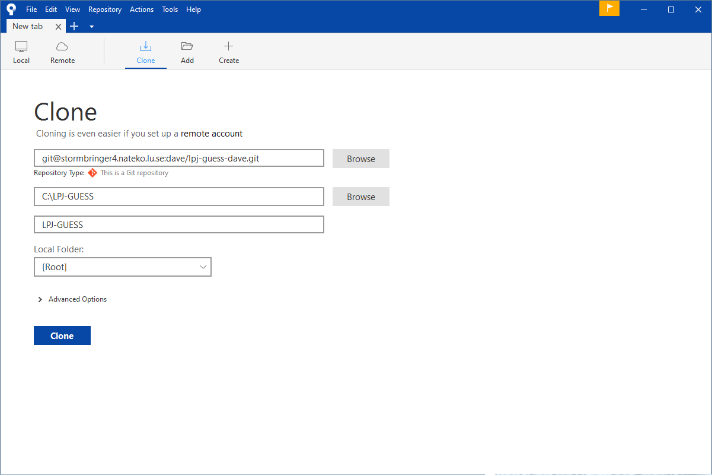
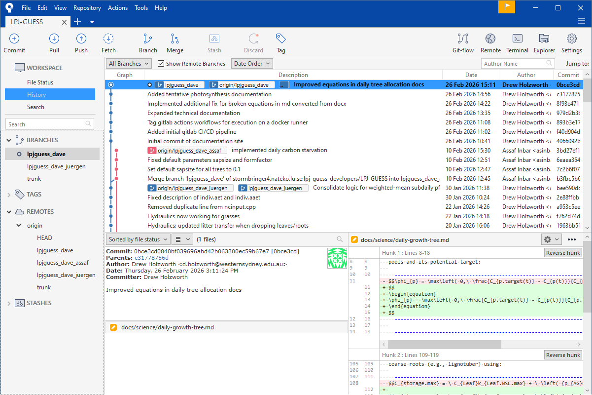
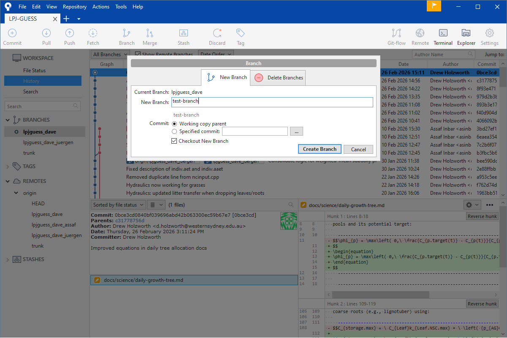
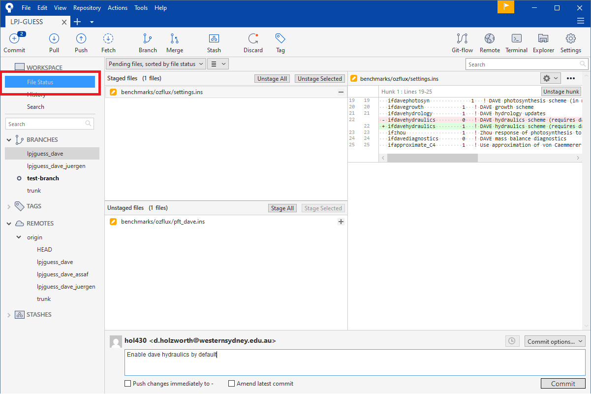
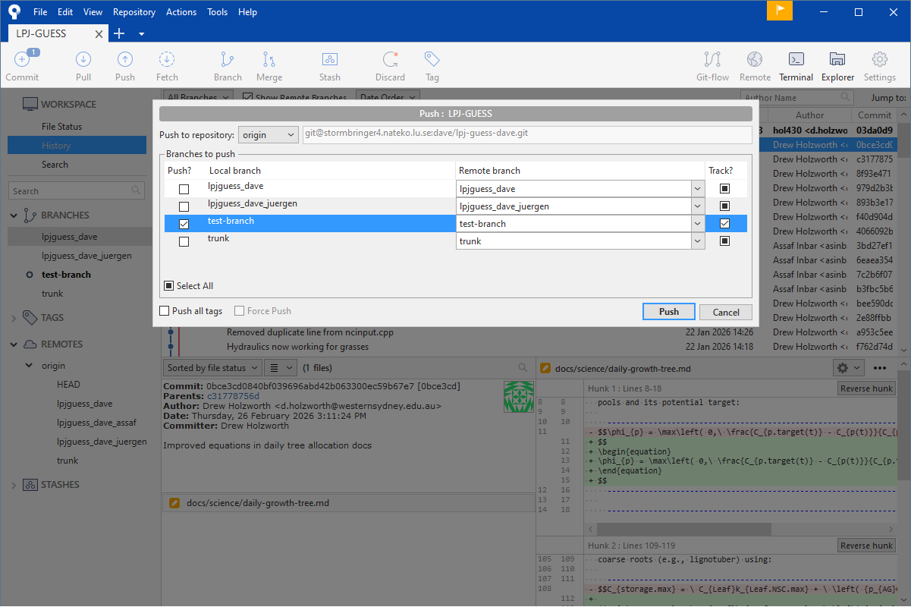
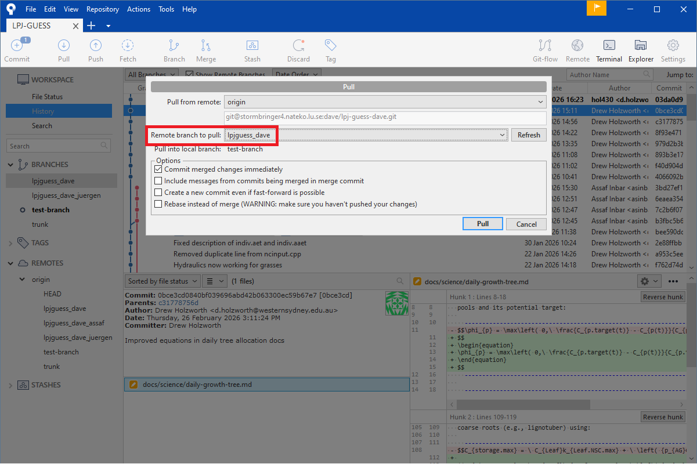

# Version Control via SourceTree

[SourceTree](https://www.sourcetreeapp.com/) is a free graphical Git client
for Windows and macOS. This page walks through the full workflow for
contributing to LPJ-GUESS DAVE — from cloning the repository to opening a
Merge Request on GitLab.

---

## Key Concepts

Git manages a complete history of changes to the codebase. Understanding a
few terms will make the rest of this guide easier to follow:

**Repository (repo)**
: The project folder plus the complete record of every change ever made to
  it. The authoritative copy lives on GitLab; everyone who works on the code
  has their own local copy.

**Commit**
: A saved snapshot of the repository at a point in time, with a short
  description of what changed and why. Commits are permanent and can always
  be recovered.

**Branch**
: An isolated line of development. The main branch (`lpjguess_dave`) always
  contains tested, reviewed code. You do your work on a separate branch so
  that the main branch is never broken by work in progress.

**Staging area**
: Before a commit is made, you choose exactly which changed files (and even
  which lines within a file) to include. This is called *staging*. It lets
  you make several unrelated edits and then commit them separately with
  meaningful descriptions.

**Remote**
: The shared copy of the repository on GitLab. "Pushing" sends your local
  commits to the remote; "pulling" brings in commits others have pushed.

**Merge Request (MR)**
: A GitLab feature. When your branch is ready, you open an MR to ask for it
  to be reviewed and merged into `lpjguess_dave`. The CI pipeline runs
  automatically and reviewers can leave comments on your changes.

---

## Core Workflow

If you already have SourceTree set up, this is the main day-to-day workflow:

1. (Optional) Create a branch for new work (or continue on your long-lived
   development branch): [Creating a Branch](#creating-a-branch)
2. Pull latest updates into your branch:
   [Bringing a Branch Up to Date](#bringing-a-branch-up-to-date)
3. Check repository state in **File Status** and edit files:
  [Check Repository State in File Status](#check-repository-state-in-file-status)
4. Stage the files for one logical change:
   [Making and Staging Changes](#making-and-staging-changes)
5. Commit your staged changes: [Committing](#committing)
6. Push your branch to GitLab: [Pushing to GitLab](#pushing-to-gitlab)
7. (Optional) Open or update a Merge Request:
   [Opening a Merge Request](#opening-a-merge-request)

The rest of this page includes setup details, deeper explanations, and
troubleshooting guidance.

---

## Installing SourceTree

Download and install SourceTree from
[sourcetreeapp.com](https://www.sourcetreeapp.com/). During setup it will ask
you to sign in with an Atlassian account. This is optional; there is no need to
do this.

You can also opt to disable merccurial support, which we won't be using.

Once installed, SourceTree will prompt you to set your user name and email. This
is important — it will be recorded in your commits. These don't strictly need to
be the same as in your GitLab account, but it's conventional to do so. You can
change these later in the settings if needed.

---

## Configure SSH Authentication in SourceTree

For LPJ-GUESS DAVE, we recommend using Git over SSH rather than HTTPS.

Using SSH is useful because it avoids repeated password prompts and avoids
relying on password-based authentication, which is increasingly restricted on
Git hosting services.

Before configuring SourceTree, make sure you have an SSH key pair and your
public key is registered with GitLab. See [SSH Key Management](ssh-keys.md)
for instructions to create a key or locate an existing one.

In SourceTree, set your SSH client and key:

1. Open **Tools → Options**.
2. In the **General** tab, go to **SSH Client Configuration**.
3. Set **SSH Client** to **OpenSSH**.
4. Select your SSH **private** key (the key file without `.pub`).
5. Click **OK**.

After this, use SSH repository URLs (`git@...`) when cloning and managing
remotes.

---

## Cloning the Repository

Cloning creates a local copy of the repository on your machine.

1. In SourceTree, open **File → New...** and select the **Clone** tab.
2. Paste the SSH repository URL into the **Source Path** field (use
  `git@...`, not `https://...`):
   ```
   git@stormbringer4.nateko.lu.se:dave/lpj-guess-dave.git
   ```
3. Set **Destination Path** to a folder on your machine
   (e.g. `C:\Users\you\code\lpj-guess-dave`).
4. Leave **Name** as the default, then click **Clone**.



SourceTree will download the full repository. This may take a minute or two
on the first clone.

---

## Overview of the SourceTree Window

Once cloned, SourceTree opens the repository view.



The key areas are:

- **Toolbar** — buttons for the most common actions: Commit, Pull, Push,
  Fetch, Branch.
- **Left sidebar** — lists your local branches, remote branches, and tags.
  The branch you currently have checked out is shown in bold.
- **Commit graph** (centre) — shows the history of commits as a timeline.
  Each dot is a commit; branches and merges are visible as lines.
- **Working Copy** entry (top of the history list) — click this to see
  your uncommitted changes.

---

## Creating a Branch

Always do new work on its own branch, never directly on `lpjguess_dave`.

1. Click the **Branch** button in the toolbar.
2. Enter a short, descriptive name in the **New Branch** field
   (e.g. `fix-canopy-conductance` or `add-thome-docs`). Use hyphens, not
   spaces.
3. Make sure **Checkout New Branch** is ticked.
4. Click **Create Branch**.



The sidebar will now show your new branch in bold, meaning it is the active
branch. Any commits you make will go onto this branch.

---

## Making and Staging Changes

Edit files in the repository folder using whatever tools you normally use
(an IDE, VSCode, a text editor). When you return to SourceTree you will see
your changes listed.

### Check Repository State in File Status

If you are unsure "what state am I in right now?", always start by opening
**File Status**. This is the main place to inspect repository state before
you commit, pull, or push.

In `File Status`, look for:

- **Ignored files**: files Git is configured to ignore (for example build
  outputs). These are typically not part of commits.
- **Untracked files**: new files Git sees but is not yet tracking. They will
  not be committed unless you stage them.
- **Unstaged files**: changed files that are not yet selected for commit.
- **Staged files**: changes that will be included in the next commit.
- No changed files in either panel: your working tree is **clean**.

A "clean working tree" simply means there are no uncommitted local file
changes. This is the safest state for pulling updates.

Click **File Status** below the toolbar to open the staging
view:



The panel has two sections:

- **Staged files** (top) — files that will be included in the next commit.
- **Unstaged files** (bottom) — files you have changed but not yet selected for
  the next commit.

To stage a file, click the checkbox to the left of its name in the
**Unstaged files** panel. It moves to **Staged files**. You can stage all
changed files at once with the **Stage All** button.

The diff viewer on the right shows exactly what changed in the selected
file — lines added in green, lines removed in red.

!!! tip
    Stage only the files related to one logical change. If you made two
    unrelated edits, stage and commit them separately with different
    descriptions. This makes the history easier to read and simplifies
    reviewing.

---

## Committing

Once you have staged the files you want, write a commit message in the text
box at the bottom of the staging view.

A good commit message:

- Is a single sentence in the imperative present tense:
  *"Fix negative VPD crash when RH input is 1.0"*
  *"Add temperature acclimation documentation"*
- Describes **why** the change was made, not just what files were touched.

Click **Commit** to save the snapshot. The commit appears immediately in the
graph — it is saved locally, but not yet on GitLab.

---

## Stashing Changes

Sometimes you want to temporarily set aside local edits without making a commit
(for example, before pulling updates).

A **stash** is a temporary shelf for uncommitted changes. You can re-apply them
later.

In SourceTree:

1. Open **File Status**.
2. Click **Stash**.
3. Enter a short message describing what was stashed.
4. Confirm to create the stash.

Later, when you are ready to restore those changes, open your stash list in
SourceTree and choose **Apply Stash** (keeps the stash) or **Pop Stash**
(restores and removes it from the stash list).

---

## Pushing to GitLab

"Pushing" sends your local commits to GitLab so others can see them and so
that they are backed up remotely.

1. Click the **Push** button in the toolbar.
2. In the dialog, make sure your branch is ticked.
3. Click **Push**.



If this is the first time you have pushed this branch, GitLab will create
a remote copy of it automatically.

---

## Bringing a Branch Up to Date

There are two common reasons to pull changes:

1. You want your long-lived development branch to include the latest commits
   from `lpjguess_dave`.
2. You made commits to *the same branch* on another machine and now want
   those commits on this machine too.

!!! warning
    Before pulling, check your repository state in [Check Repository State in
    File Status](#check-repository-state-in-file-status) and make sure your
    working tree is clean.

    If it is not clean, either commit your changes (see
    [Committing](#committing)) or stash them (see
    [Stashing Changes](#stashing-changes)).



### Workflow A: Bring in Latest `lpjguess_dave` Changes

1. Click **Fetch** in the toolbar to update remote-tracking branches.
2. Check out your development branch in the left sidebar.
3. Click **Pull**.
4. In the pull dialog, choose `origin/lpjguess_dave` as the branch to pull from.
5. Choose one integration method:
  - **Merge** (simpler, safer default for beginners)
  - **Rebase** (cleaner history; rewrites your local branch commits)
6. Complete the pull and resolve any conflicts if prompted.

### Workflow B: Pull Your Own Branch from Another Machine

If you pushed commits from another computer to the same branch name:

1. Click **Fetch**.
2. Check out that branch locally.
3. Click **Pull** and pull from the matching remote branch (e.g.
   `origin/my-feature-branch`).

This updates your local branch with the commits you already pushed from the
other machine.

### Merge vs Rebase (Which Should I Use?)

- **Merge** adds a merge commit and keeps the exact branch history.
- **Rebase** replays your commits on top of newer commits, creating a more
  linear history.

For this project, a practical rule is:

- Use **Merge** if you are unsure or if multiple people share the branch.
- Use **Rebase** if you are comfortable with Git and want a cleaner history
  before opening/updating an MR.

Avoid rebasing commits that have already been pulled by collaborators unless
your team has explicitly agreed to that workflow.

### Resolving Conflicts in SourceTree

When Git reports a conflict, it means both sides changed overlapping parts of
the same file and Git cannot safely decide which version to keep.

In conflict markers, you will often see:

```text
<<<<<<< HEAD
your current branch changes
=======
incoming branch changes
>>>>>>> origin/lpjguess_dave
```

- The block above `=======` is your current branch version.
- The block below `=======` is the incoming version.
- You resolve the conflict by choosing one side, or combining both, then
  removing the markers.

Practical SourceTree workflow:

1. In **File Status**, locate files marked as conflicted.
2. Open each conflicted file in the merge tool or your editor.
3. For each conflict, choose **Mine**, **Theirs**, or edit manually to keep
  the correct final content.
4. Save the file after all markers are removed.
5. Stage the resolved file.
6. Continue the operation:
  - For a merge-based pull: complete the merge commit.
  - For a rebase-based pull: click **Continue Rebase**.

Repeat until no conflicted files remain.

---

## Opening a Merge Request

Once your branch is pushed:

1. Open the repository on GitLab in your browser.
2. GitLab will usually show a banner: **"You pushed a branch — create a
   Merge Request."** Click the **Create Merge Request** button.
3. Fill in the title and description. The description should explain what
   the change does and how to test it.
4. Set **Target branch** to `lpjguess_dave`.
5. Submit the MR.

The CI pipeline will run automatically. Your MR can be merged once the
pipeline passes and a reviewer has approved it.

!!! note
    You do not need to open a new MR every time you push. If you push
    additional commits to the same branch, they appear in the already-open
    MR automatically.
