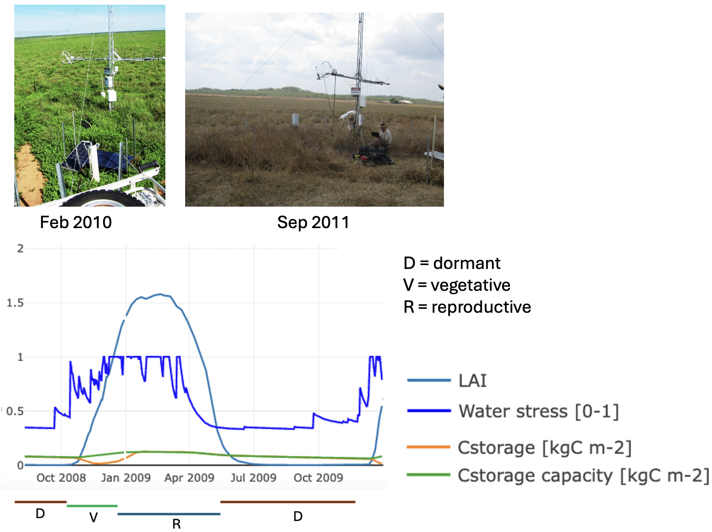

# Daily Grass Growth

## General model structure

In the following, we present the DAVE-Grass model. The version presented here
([commit hashtag]{.mark}) is embedded into the LPJ-GUESS dynamic vegetation
model (refs). The model is highly modular and as such can be readily transferred
to any other land surface or dynamic vegetation model.

The model can be applied at the site level (e.g. at eddy covariance or phenocam
locations), as well as in gridded simulations that cover larger areas, including
continental and global scales. In all cases, the spatial heterogeneity of the
unit of interest (whether a site or grid cell) is represented by patches
(usually n \> 20) that vary based on the time since the last disturbance. In
each patch, herbaceous plant functional types (PFTs) are represented by a single
'average' individual, which means that different age classes are not
distinguished. Therefore, spatial heterogeneity is captured exclusively through
the representation of patches, with the final output for a site or grid cell
calculated as the average across patches.

DAVE-Grass simulates biogeochemical processes (e.g. growth, storage dynamics,
allocation, N cycling) as well as demographic processes (e.g. establishment,
competition) at the daily time scale but uses sub-daily time steps (usually
half-hourly to 3-hourly) for 'fast processes' such as photosynthesis and
available radiation.

## Plant functional types

The model distinguishes four herbaceous plant functional types according to
their life cycle and photosynthetic pathway: $C_3$ perennial herbaceous, $C_3$
annual herbaceous, $C_4$ perennial herbaceous, and $C_4$ annual herbaceous. The
PFTs differ in various key traits (e.g. SLA, N:C ratios, allocation fraction to
reproductive tissues) as well as functional behaviour (e.g. higher senescence in
annuals compared to perennials, temperature responses).

[Fig. 1:]{.mark} diagram showing PFTs and their most important
differences + all structural and non-structural pools.

## Plant structure

The model represents four structural carbon pools in the plant: shoots, roots,
crowns, and reproductive tissues, and one non-structural (storage) pool (Figure
XX). All carbon pools are in $kg C m^{-2}$.

---
$$
C_{total} = C_{struct} + C_{storage}
\tag{1} 
$$

---
$$
C_{struct}\  = {\ C}_{shoot}\  + \ C_{root}\  + \ C_{crown}\  + {\ C}_{repr} \tag{2} 
$$

---

Shoots are divided into culm and leaf components according to a culm
fraction parameter $p_{culm}$.

---
$$
C_{shoot}\  = C_{leaf} + C_{culm} \tag{3} 
$$

---
$$
C_{leaf}\  = C_{shoot} \times \ (1.0 - p_{culm}) \tag{4} 
$$

---

Green leaf area index (LAI) is then calculated as:

---
$$
LAI = C_{leaf} \times SLA + C_{culm} \times SCA\  \tag{5} 
$$

---

where SLA is specific leaf area ($m^2$ kg$^{-1}$ C) and SCA is specific culm
area ($m^2$ kg$^{-1}$ C). Parameters $p_{culm}$, SLA, and SCA are assumed
constant over the course of the developmental cycle but differ among
PFTs (see Table X). [Justify.]{.mark}

The crown constitutes the interface between above-ground and
below-ground components and is located partly above- and belowground,
but for simplicity is assumed to be located belowground in the model
(Fig. 1).

The storage pool ($C_{storage}$) represents non-structural carbohydrate
(NSC) reserves in the plant, including glucose, sucrose, starch, and
other carbohydrates of varying complexity (ref). This pool does not have
an explicit location within the plant, but its maximum capacity
($C_{storage,max}$) depends on the individual pool sizes as follows:

---

$$
C_{storage,max} = p_{storage1} \times \left( C_{shoot} + C_{root} \right) + p_{storage2} \times C_{crown} \tag{6} 
$$

---

where $p_{storage1}$ and $p_{storage2}$ represent the maximum fraction of
NSCs relative to structural C of the pools where it is located in
(shoots and roots for $p_{storage1}$, and crown for $p_{storage2}$). Eq.
(6) assumes that 1) the overall size of the NSC pool in the plant
depends on the size of the plant, and 2) that most of the NSCs are
typically stored in crowns, with smaller concentrations also found in
roots and leaves (refs).

For shoots, the senescence of $C_{shoot}$ into a brown shoot pool
($C_{shoot,brown}$) is tracked. The green pool represents physiologically
active shoot components (leaves and culms) and the brown pool represents
physiologically inactive and fully senesced (standing dead) components.
Brown LAI can be calculated from Eq. (5) using brown instead of green C
pools. Brown components of other structural C pools are not tracked.

[Fig. 2:]{.mark} Illustrative figure showing the three phenological
phases, LAI, NSC content.

## Radiation transfer and leaf-to-canopy scaling

The canopy is assumed horizontally homogenous and discretised along LAI,
each layer having a prescribed depth of LAI (0.5 by default). The model
assumes radiation transfer within the canopy according to the
Beer-Lambert law (ref). The incident PAR $I_{inc}$ ($W m^{-2}$) in the
middle of layer $i$ is given by:

---
$$
I_{inc,i} = \frac{k}{1 - \ \tau}\ I_{0}\ e^{- kL}\  \tag{7} 
$$

---

where $k$ is the canopy light extinction coefficient, $I_0$ is the PAR
above the canopy ($W m^{-2}$), and $L$ is the cumulative leaf area (summed
across all PFTs) at the middle of layer $i$.

Light competition among herbaceous PFTs is accounted for by the
distribution of LAI across the layers. Here we assume that PFTs have
their leaf area distributed equally across all layers.

We assume the following distribution of N within the canopy:

---
$$
{rN}_{i} = exp( - k_{n}\ L) \tag{8} 
$$

---

where $rN_{i}$ is the N content of layer $i$ relative to the top of the
canopy, and $k_{n}$ is the canopy N extinction coefficient (Hikosaka et
al., 2016).

## Photosynthesis and stomatal conductance

Photosynthesis is modelled according to Farquhar et al. (1980) for $C_3$
plants and von Caemmerer (2000) for $C_4$ plants. Detailed Equations and
parameter values are given in Appendix A. Stomatal conductance for water
vapour ($g_{sw}$) is modelled according to Lombardozzi et al. (2017) and
Duursma et al. (2019), based on the Medlyn et al. (2011) model for both
$C_3$ and $C_4$ plants:

---
$$
g_{sw} = \max\left( {\max(g_{\min},g}_{0}),\ 1.6\left( 1 + \ \frac{g_{1}}{\sqrt{D}} \right)\frac{A_{n}}{C_{a}} \right) \tag{9} 
$$

where $g_{min}$ is the minimum stomatal conductance ($\text{mol m}^{-2}
\text{s}^{-1}$), $g_0$ is the stomatal conductance at night under unstressed
conditions ($\text{mol m}^{-2} \text{s}^{-1}$), $g_1$ is the stomatal slope
parameter (kPa^0.5^), $A_n$ is net photosynthesis, D is vapour pressure deficit
at the leaf surface (kPa), and $C_a$ is $CO_2$ concentration at the leaf surface
($\text{mol mol}^{-1}$). [Describe advantages of this formulation compared to
original one.]{.mark}

## Respiration

Plant (autotrophic) respiration is given as the sum of maintenance
respiration ($R_{m}$) and growth respiration ($R_{g}$). $R_{m}$ is
calculated individually for different plant pools and for a given pool x
is given by:

---

$$
R_{m,x} = k_{rm}\frac{C_{x}}{\chi_{x}^{C:N}}\ T\ \  \tag{10} 
$$

---

Where $k_{rm}$ is a respiration coefficient, $C_{x}$ is the carbon mass of
plant pool x ($\text{kg C m}^{-2}$), $\chi_{x}^{C:N}$ is the C:N ratio of pool x,
and $T$ is the driving temperature for respiration ($T_{air}$ for the
reproductive pool and $T_{soil}$ for all other pools). Note that
$R_{m,shoot}$ is calculated as part of the photosynthesis routine (Eq.
AX).

Growth respiration ($R_{g}$) is calculated on a whole-plant basis as
([ref]{.mark}):

---
$$
R_{g} = \left( GPP - {R_{m,shoot} - R}_{m,root} - R_{m,crown} - R_{m,repr} \right) \times 0.25 \tag{11} 
$$

---

Daily net primary production (NPP, $\text{kg C m}^{-2} \text{d}^{-1}$) is given by:

---
$$
NPP = GPP - R_{m} - R_{g} \tag{12} 
$$

---

## Growth

### Source strength

Source strength ($\text{kg C m}^{-2} \text{d}^{-1}$) is here defined as the
external C input (i.e. net primary productivity, NPP) plus the amount of C that
can be provided internally from $C_{storage}$:

---
$$
G_{source} = NPP + r_{mobil,max} \times (C_{storage} - p_{reserve} \times \ C_{storage,max}) \tag{13} 
$$

---

where $r_{mobil,max}$ (d^-1^) represents the maximum mobilisation rate of
the storage pool and $p_{reserve}$ represents the fraction of $C_{storage}$
that is unavailable for growth and kept as a reserve.

### Sink strength

Sink strength is here defined as the demand for growth ($\text{kg C m}^{-2}
\text{d}^{-1}$) and is calculated as:

---
$$
G_{sink} = {RGR}_{pot} \times {(C}_{storage} + {\ C}_{shoot}\  + \ C_{root}) \times f_{dev,growth} \times \ f_{temp,growth} \times \ f_{water,growth} \tag{14} 
$$

---

where $RGR_{pot}$ is the potential relative growth rate of the plant ($\text{kg
C kg}^{-1} \text{C d}^{-1}$), $f_{dev,growth}$ describes developmental effects
on sink strength, $f_{temp,growth}$ describes the temperature dependence of
processes related to growth, and $f_{water,growth}$ represents the inhibition of
growth under water stress. The effects of photoperiod on developmental and
growth processes (e.g. Hay, 1990) are not considered in the current model
version but may be included in the future development of the model.

The decreasing growth demand throughout the reproductive phase of the plant is
here simulated depending on the fraction of reproductive biomass to shoot
biomass:

---
$$
f_{dev,growth} = \left( 1\  - \ d_{1} \times \frac{C_{repr}}{C_{shoot} \times \ a_{repr}} - d_{2}\  \right) \tag{15} 
$$

---

Where $d_{1}$ and $d_{2}$ are seasonality parameters determining the timing of
growth demand in the reproductive period, and $a_{repr}$ is the
allocation fraction to the reproductive pool.

Sink strength is further affected by environmental conditions, foremost
temperature and water stress. The temperature response of growth and
other developmental processes (e.g. germination) follows the one
presented in Parent & Tardieu (2012):

---
$$
f_{temp,growth}(T_{leaf}) = \ \frac{A\ T_{leaf}\ exp\left( \frac{{- H}_{a}}{R_{gas}\ T_{leaf}} \right)}{1.0 + \ \left( \exp\left( \frac{{- H}_{a}}{R_{gas}T_{leaf}} \right) \right)^{\propto \left( 1.0\  - \ \frac{T_{leaf}}{T_{0}} \right)}}\  \times \ k_{g} \tag{16} 
$$

---

where $A$ is a scaling coefficient which is here further modified to scale
$f_{temp,growth}$ between 0 and 1, with 1 being reached at the optimum
temperature for growth ($T_{opt}$). $T_{leaf}$ is the average daily leaf
temperature (K), $H_{a}$ is the activation energy ($\text{J mol}^{-1}$),
$R_{gas}$ is the universal gas constant (8.314 $\text{J mol}^{-1}
\text{K}^{-1}$), α is a dimensionless parameter determining the sharpness of the
decrease at high temperatures, and $T_{0}$ (K) is a parameter affecting the
value of $T_{opt}$. $k_{g}$ is a modifier that accounts for the fact that Eq.
(16) does not hold under low temperatures close to or below $T_{dorm}$. $k_{g}$
is defined as:

---

$$
k_g = \begin{cases}
1 & \text{if } T_{leaf} \geq T_{dorm} \\
1 - \min(1, (T_{dorm} - T_{leaf}) \times 0.5) & \text{if } T_{leaf} < T_{dorm}
\end{cases}

\tag{17}
$$

---

Eq. (17) represents a relatively sudden decrease of growth below
$T_{dorm}$. Such a threshold behaviour is [often]{.mark} observed in
temperature response curves of growth (Körner, 2008).

As noted in Parent & Tardieu (2012), Eq. (16) integrates multiple
processes rather than individual enzyme activities, resulting in
parameters losing their biochemical interpretation. Therefore, Eq. (16)
was preferred over a modified Arrhenius equation for the representation
of temperature effects on growth and developmental processes.

Growth demand is further modified by a water stress scalar which assumed
to by a sigmoidal function of available soil water content:

---
$$
f_{water,growth}\left( w_{scal} \right) = \ \frac{\left( 1 + exp\left( \frac{w_{scal0} - 1}{b_{1}} \right) \right)}{\left( 1 + exp\left( \frac{w_{scal0} - w_{scal}}{b_{1}} \right) \right)} \tag{18} 
$$

---

where $w_{scal}$ is a water availability scalar describing the available
soil water content in the rooting zone (see Appendix B). $w_{scal}$
ranges from 0 to 1, where 0 represents the wilting point (i.e. maximum
water stress) and 1 field capacity (absence of water stress).

### Growth Rate

The actual growth rate $G$ ($\text{kg C m}^{-2} \text{d}^{-1}$) is given by the
minimum of the source strength and the sink strength:

---
$$
G = \min(G_{source},G_{sink}) \tag{19} 
$$

---

If $G = G_{source}$ (i.e. $G_{source} < G_{sink}$), plants are
considered source-limited, in which case C is actively drawn from
storage to support growth. [Double check: only in this case?]{.mark} If
$G = G_{sink}$ (i.e. $G_{sink} < G_{source}$), plants are considered
sink limited and tend to replenish their carbon storage.

## Source-sink feedbacks

Various molecular feedback mechanisms exist in plants that ensure a
balance between sink and source processes (A. C. White et al., 2016).
The model represents two main feedback mechanisms between sink and
source strength, which are both mediated by the size of the $C_{storage}$
pool.

Under source-limited conditions, such as in the early vegetative phase,
C is usually drawn from storage. The following negative feedback
prevents $C_{storage}$ from a complete depletion which would put the plant
at risk of carbon starvation:

---
$$
f_{storage,feedback} = \ {p_{Cstorage}}^{q_{f1}} \tag{20} 
$$

---

Where $p_{Cstorage}$ represents the fraction of $C_{storage}$ that is
available for growth relative to the capacity of the $C_{storage}$ pool
($C_{storage,max}$) and $q_{f}$ is a parameter determining the strength of
the feedback (Table X). $p_{Cstorage}$ is calculated as:

---
$$
p_{Cstorage} = \ \left( \frac{C_{storage} - \ p_{reserve} \times \ C_{storage,max}\ }{C_{storage,max}\  - \ p_{reserve} \times \ C_{storage,max}} \right) \tag{21} 
$$

---

$f_{storage,feedback}$ is directly applied to $G_{sink}$ (Eq. (14)) and
serves to reduce growth demand when storage approaches depletion. The
$q_{f}$ parameter is assumed to be higher in the reproductive compared to
the vegetative phase, representing a more conservative behaviour with
respect to storage utilisation in the late growing season (refs).

Under sink-limited conditions, such as often observed in the
reproductive phase, NSCs will accumulate in the plant until the physical
capacity of the storage pool ($C_{storage,max}$, Eq. (6)) is reached. If
$C_{storage}$ approaches $C_{storage,max}$, a negative feedback on
photosynthetic capacity is invoked as follows:

---
$$
q_{ps,lim} = \min\left( 1,\ \left( 1 + d_{ps,lim} - 2\ \left. \  \times {({f_{dorm}(T_{soil1},\ w_{scal}) \times p}_{Cstorage})}^{q_{f2}} - 1 \right.\  \right){\times q}_{{ps,lim}_{t - 1}} \right)\  \tag{22} 
$$

---

where $q_{ps,lim}$ is a downregulation factor applied to parameters of
photosynthetic capacity, $q_{ps,lim_{t-1}}$ is its value at the previous
time step, and $d_{ps,lim}$ is the maximum change of $q_{ps,lim}$ per time
step. As apparent in Eq. (6), photosynthetic activity is upregulated
again when $p_{Cstorage}$ falls below a certain value depending on
$q_{f2}$.

## Fate of 'excess carbon'

Eq. (22) reduces photosynthetic capacity and thus $G_{source}$ in the
following day but it does not always prevent $C_{storage}$ from exceeding
$C_{storage,max}$. In that case, the 'excess carbon' ($C_{excess}$) that
cannot be placed into $C_{storage}$ must be either allocated to structural
plant pools or discarded through other pathways. In the current version
of the model, a limited fraction of $C_{excess}$ is first allocated to
$C_{repr}$ if the plant is in the reproductive phase in both annuals and
perennials. In perennials, a limited fraction of the remaining $C_{excess}$
is additionally allocated to crowns. Any $C_{excess}$ that cannot be
allocated to structural pools, either due to potential excessive growth
or stoichiometric constraints, is respired. Other potential pathways of
$C_{excess}$, such as root exudation fluxes, may be accounted for in future
model developments.

## Carbon allocation

Carbon from growth is allocated to the four structural pools so that
growth of pool x can be expressed as:

---
$$
G_{x} = a_{x}\ G \tag{23} 
$$

---

where $a_{x}$ represents the C allocation fraction to pool x.

A constant, PFT-specific fraction of $G$ ($a_{crown}$) is first allocated
to the crown. The rationale is that the crown as the interface between
above- and belowground components supports growth of any other plant
pool and thus needs to grow along with overall growth of the plant.

The allocation fraction to reproductive tissues ($a_{repr}$) is zero in
the vegetative phase and a constant, PFT-specific fraction in the
reproductive phase (Table XX). The remaining $G$ is then allocated to
shoots and roots depending on water and nitrogen stress. We adopted a
similar formulation as presented in Johnson (2016) to determine the
allocation fraction to shoots:

---

$$
a_{shoot} = \ a_{shoot,max}\  \times {{(n}_{scal}\  \times \ w_{scal})}^{0.5} \tag{24} 
$$

---

where $a_{shoot,max}$ is the maximum allocation fraction to shoots and
$n_{scal}$ and $w_{scal}$ are scalars describing nitrogen and water
stress, respectively. Both factors range from 0-1 where 0 indicates
maximum stress and 1 represents unstressed conditions. Finally,
$a_{root}$ is given by:

---

$$
a_{root} = \ 1.0 - \ a_{crown} - \ a_{repr} - \ a_{shoot} \tag{25} 
$$

---

In annual plants*, $a_{crown}$ is set to 0 in the reproductive stage. In
perennial plants younger than one year, $a_{crown}$ is multiplied by 2
and $a_{repr}$ is reduced accordingly. These adjustments reflect the
prioritisation of vegetative growth over reproductive growth in young
perennials (Cheplick, 2021; Pitelka, 1977).

## Phenology

DAVE-Grass distinguishes three phenological stages: vegetative,
reproductive, and dormant. All three stages are reached in response to
external or internal cues (Figure XX). The transition from one stage to
another does not follow a prescribed (thermal) time and may vary
depending on the conditions each year. For example, plants may remain
dormant or stay in the vegetative phase if the conditions are
unfavourable for plant growth. Dormancy may be absent completely in
climates without significant seasonal temperature or water limitations.

### Dormancy

Dormancy is characterised by reduced metabolic activity in response to
prolonged periods of unfavourable environmental conditions (e.g.
Gillespie & Volaire, 2017). In the model, dormancy is triggered by
either low temperatures or low soil moisture contents in the rooting
zone and represented as a metabolic downregulation function ($f_{dorm}$):

---
$$
f_{dorm}(T_{soil1},\ w_{scal}) = {min(1.0,\ max(p}_{dorm,min},\ d_{dorm,max} \cdot \ min(f_{temp,dorm}(T_{soil1}),f_{water,dorm}(w_{scal}))) \tag{26} 
$$

---

where $p_{dorm,min}$ represents a baseline level of metabolic activity at
full dormancy (i.e. the minimum value of $f_{dorm}$), which is assumed to
be 0.1 here according to respiration rates in full dormancy relative to
the vegetative phase in different plant tissues (Myking, 1998; Shane et
al., 2009). $d_{dorm,max}$ is the maximum change of $f_{dorm}$ per day,
and $f_{temp,dorm}$ and $f_{water,dorm}$ are functions (ranging from 0
to 1) controlling dormancy based on temperature and water availability,
respectively. Eq. (26) demonstrates that dormancy is represented as a
continuum with varying levels of metabolic activities, rather than an
'on -- off' switch. This representation allows for partial dormancy as
often observed in grasses and other herbaceous plants (ref). For many
subsequent applications, it is useful to rescale $f_{dorm}$ and express
it as 'dormancy depth' ($q_{dorm}$) ranging from 0 (non-dormant) to 1
(fully dormant):

---
$$
q_{dorm} = \ \frac{1\  - \ f_{dorm}\left( T_{soil1},\ w_{scal} \right)\ }{1\  - \ p_{dorm,min}} \tag{27} 
$$

---

In the model, plants change their dormancy depth according to the
temperature of the first soil layer averaged over a certain preceding
time window, here assumed to be 10 days
($\overline{T_{soil1,t - 9:t}}$). Specifically, plants enter dormancy if
the average $T_{soil1}$ falls below a critical dormancy temperature
($T_{dorm}$) and release dormancy (or remain non-dormant) if the average
$T_{soil1}$ is greater than $T_{dorm}$:

---

$$
f_{temp,dorm}(T_{soil1}) = \begin{cases}
f_{temp,growth}(\overline{T_{soil1,t - 9:t}})^{q_{temp,dorm}} & \text{if } \overline{T_{soil1,t - 9:t}} > T_{dorm} \\
\frac{f_temp,growth\left(\overline{T_{soil1,t - 9:t}}\right) - f_{temp,growth}(T_{dorm})}{f_{temp,growth}(T_{dorm})} & \text{if } \overline{T_{soil1,t - 9:t}} \leq T_{dorm}
\end{cases}
\tag{28}
$$

---

where $f_{temp,growth}(\overline{T_{soil1,t - 9:t}})$ is the
temperature response function for growth as given by Eq. (16) but with
$\overline{T_{soil1,t - 9:t}}$ as the driving temperature.

Similarly, plants change their dormancy status depending on the
available soil water in the rooting zone ($w_{scal}$, Eq. (B2)). We assume
that plants fall dormant when $w_{scal}$ falls below a critical threshold
for dormancy ($w_{scal,dorm}$).

---
$$
f_{water,dorm}(w_{scal}) = \begin{cases}
\frac{(w_{scal} - w_{scal,dorm})^{q_{water,dorm}}}{1 - w_{scal,dorm}} & \text{if } w_{scal} > w_{scal,dorm} \\
\frac{(w_{scal} - w_{scal,dorm})}{w_{scal,dorm}} & \text{if } w_{scal} \leq w_{scal,dorm}
\end{cases}
\tag{29}
$$

---

where $w_{scal,dorm}$ is the fraction of available water content below
which plants fall dormant. The exponent $q_{water,dorm}$ is here set to
1.5. This behaviour mirrors a more cautious approach of plants of not
resuming metabolic activities too quickly after a small rain event.

The primary effects of dormancy are reduced metabolic activity, reduced
or ceased growth, and increased senescence rates (Gillespie & Volaire,
2017; Volaire & Norton, 2006). In the model, these effects are captured
by applying $f_{dorm}$ as a scaling factor to photosynthetic and
respiration parameters, and $q_{dorm}$ to senescence (Eq. XX), and growth
(Eq. XX).

### Vegetative and Reproductive Phase

Plants transition from the dormant phase to the vegetative phase when
conditions improve, i.e. when $f_{dorm}$ exceeds $p_{dorm,min}$ (Eq.
(26)). The reproductive phase is reached when the following conditions
are met: 1) a positive internal carbon balance (i.e. positive trend in
$C_{storage}$) over the preceding 15 days, 2) $C_{storage}$ at least 70% full.
The transition from vegetative to reproductive growth is accompanied by
a range of physiological changes in herbaceous plants characterised
by 1) C allocation to reproductive tissues, 2) decreasing overall growth
rates (Jungers et al., 2018; Koelewijn, 2004), and 3) increasing
senescence rates (Noodén et al., 1997; Yang & Udvardi, 2018). These
effects are accounted for in the model as described in full detail in
the sections below.

The reproductive phase ends either when plants enter full dormancy (i.e.
$q_{dorm} = 1$) or when the relative daily increase in $C_{repr}$ approaches
0. In the latter case, plants are assumed to re-enter the vegetative phase,
starting with a reduced $f_{dev,growth}$ equal to XX. and is subsequently
increased according to conditions (using Eq. XX). This reduction in growth
demand is needed to avoid rapid growth right after the end of the reproductive
period.

## Shoot Senescence

The model tracks the flow of C from the green shoot pool ($C_{shoot}$) to
the brown shoot pool ($C_{shoot,brown}$), a process known as senescence
($k_{senesc}$):

---
$$
\frac{dC_{shoot,brown}}{dt} = k_{senesc} \times C_{shoot} - k_{shoot,brown} \times \ C_{shoot,brown}\  \tag{30} 
$$

---

Where $k_{shoot,brown}$ is the turnover rate from the brown shoot pool to litter
which is described in the next section. The senescence rate depends on the
environmental conditions and the growth stage of the plant and is higher in the
reproductive and dormant phases compared to the vegetative phase. The shoot
senescence rate on any given day is calculated as:

---
$$
k_{senesc} = \min\left( {1.0,\ \ k}_{senesc,base} \times \left( \left( {1 + max}\left( f_{dev,senesc},f_{dorm,senesc} \right) \right) + \left( 1 + f_{water,senesc} \right) \right) \times (1 + f_{temp,senesc}) \right)
\tag{31}
$$

---

where $k_{senesc,base}$ is the base rate of senescence under unstressed
conditions (Table 1), $f_{dev,senesc}$ describes plant developmental
effects on senescence, $f_{dorm,senesc}$ represents the effects of
dormancy and $f_{water,senesc}$ and $f_{temp,senesc}$ describe the effects
of soil water stress and temperature on senescence, respectively. Other
potential mechanisms explaining senescence, such as light and nutrient
limitations (Yang & Udvardi, 2018), are not considered in the current
model version.

We assume that shoot senescence is linked to the decrease in growth
demand during the reproductive phase (Eq. (15) as follows:

---
$$
f_{dev,senesc} = \begin{cases}
s_{dev,senesc} \times \left( 1 - f_{dev,growth} \right)^{q_{dev,senesc}} & \in \text{reproductive} \wedge \text{dormant phase} \\
0 & \in \text{vegetative phase}
\end{cases}
\tag{32}
$$

---

where $s_{dev,senesc}$ is a scaling factor determining the maximum
senescence rate caused by developmental effects. The exponent
$q_{dev,senesc}$ determines the rate of increase in senescence during the
reproductive and dormant phase.

Dormancy is another mechanism associated with increasing senescence
rates (Gillespie & Volaire, 2017; Volaire & Norton, 2006). This
phenomenon is represented here through the following formulation:

---
$$
f_{dorm,senesc} = s_{dorm,senesc} \times q_{dorm} \tag{33} 
$$

---

where $s_{dorm,senesc}$ is a scaling factor representing the maximum
increase in senescence rate under full dormancy, and $q_{dorm}$ is the
degree of dormancy (0-1) as given by Eq. (XX). Thus, $f_{dorm,senesc}$
may take values \> 0 as soon as dormancy starts to develop, not just in
the dormant phase.

Water stress increases shoot senescence as follows:

---
$$
f_{water,senesc}(w_{scal}) = s_{water,senesc}\  \times (1 - \ {w_{scal}}^{q_{water,senesc}}) \tag{34} 
$$

---

where $s_{water,senesc}$ is a scaling factor representing the maximum increase
in senescence rate under soil water stress and $q_{water,senesc}$ is an exponent
determining the shape of the response. Lastly, a linear temperature dependence
is added similar to Johnson & Thornley (1983), but additionally assuming
increasing senescence rates under freezing temperatures (Jouven et al., 2006):

---
$$
f_{temp,senesc} = \begin{cases}
b_{senesc1} \times |T_{air}| & \text{if } T_{air} \leq 0^\circ C \\
0 & \text{if } T_{air} > 0^\circ C \text{ and } T_{air} < T_{dorm} \\
b_{senesc2} \times \left(T_{air} - T_{dorm}\right) & \text{if } T_{air} \geq T_{dorm} \\
\end{cases}
\tag{35}
$$

---

where $b_{senesc1}$ and $b_{senesc2}$ are the sensitivities of the senescence
rate to $T_{air}$ (°C) below 0°C and above $T_{dorm}$, respectively.

## Plant turnover

The turnover rate of the brown shoot pool ($C_{pool,brown}$) into the shoot
litter pool is simulated as follows:

---

$$
k_{shoot,brown} = k_{shoot,base}\  \times \ f_{temp,decomp}\  \times \ f_{water,decomp} \tag{36} 
$$

---

where $k_{shoot,base}$ is the baseline decomposition rate at 10 °C,
$f_{temp,decomp}$ and $f_{water,decomp}$ describe the temperature and soil
moisture dependence functions of litter decomposition. The temperature
dependence is given by Lloyd & Taylor (1994):

---
$$
f_{temp,decomp}(T_{air})\  = \exp\left( 308.56\  \times \left( \frac{1}{56.02} - \frac{1}{T_{air} + 46.02} \right)\  \right) \tag{37} 
$$

---

We use $T_{air}$ as driving temperature in Eq. (37), but note that
$T_{soil1}$ could also be a meaningful alternative for the decomposition
of biomass close to the ground. The soil moisture response is given by
the following logistic function (Parton et al., 2000):

---
$$
f_{water,decomp}(w_{cont1})\  = \frac{1}{1 + 30 \times exp( - 8.5\ {\times w}_{cont1})} \tag{38} 
$$

---

where $w_{cont1}$ (Eq. (B1) is the relative soil moisture of the
uppermost soil layer.

Root turnover rate ($k_{root}$) is assumed to be proportional to shoot
base turnover rate ($k_{senesc,base}$, Eq. (31) but follows different
environmental dependencies:

---
$$
k_{root} = {r_{k,root:shoot}\  \times k}_{senesc,base}\  \times f_{temp} \tag{39} 
$$

---

where $r_{k,root:shoot}$ is the ratio of root base turnover rate to shoot
base turnover rate.

Crown turnover ($k_{crown}$) is assumed to be proportional to $k_{root}$:

---
$$
k_{crown} = {r_{k,crown:root}\  \times k}_{root} \tag{40} 
$$

---

where $r_{k,crown:root}$ is the ratio of crown base turnover rate to root
base turnover rate.

As in the LPJ-GUESS model, the C that is turned over is transferred to
litter pools ($C_{shoot,brown}$ to $C_{litter,shoot}$, and $C_{root}$ and
$C_{crown}$ to $C_{litter,root}$), which partly respire and partly turn over
into various soil pools. For a detailed description on soil and litter C
decomposition, see REF.

## Mortality

In the current model version, carbon starvation is the sole mechanism of
plant mortality. That means that an individual dies when its carbon
storage ($C_{storage}$) reaches zero. Carbon starvation is here considered
as a representative mechanism for plant mortality as $C_{storage}$
integrates the effects of a range of external factors (climate, nutrient
availability) along with plant characteristics (size, storage capacity,
competitiveness, etc.). Thus, mortality caused by low $C_{storage}$ is
assumed to integrate a range of causes linked to various stress factors.

After mortality occurred, C and N from different plant pools are
transferred to the respective litter pools. The PFT may persist through
its seedbank and re-establish if conditions if conditions become
favourable.

## Seedbank

At the end of the reproductive period, a fraction of $C_{repr}$ enters the
reproductive litter pool ($C_{litter,repr}$), which represents the seedbank
of the PFT. $C_{litter,repr}$ is also continuously turned over according to
the seed turnover rate $k_{litter,repr}$. The change of C in the
seedbank is thus given by:

---
$$
\frac{dC_{litter,repr}}{dt} = \ {k_{repr}\  \times p}_{seed} \times C_{repr} - \ k_{litter,repr\ } \times C_{litter,repr} \tag{41} 
$$

---

where $p_{seed}$ represents the fraction of $C_{repr}$ that is composed of
viable seeds and $k_{repr}$ represents the fraction of $C_{repr}$ being
flushed to litter. For simplicity, $k_{repr}$ takes a value of 1 on the
last day of the reproductive phase and 0 on all other days, which means
that all seeds are shed on a single day.

The seedbank turnover rate $k_{litter,repr}$ depends on the moisture and
temperature of the first soil layer in the same way as $k_{shoot,brown}$
(Eq. (36), but with a different baseline turnover rate. The
environmental dependencies of turnover (Eq. (36) allow seeds to stay
viable for longer under dry and cool conditions. The remainder of
$C_{repr}$, (i.e. (1 -- $p_{seed}$) \* $C_{repr}$) represents supporting
structures such as shafts and bracts, which are added to the shoot
litter pool ($C_{litter,shoot}$) after seed shedding.

## Germination

Germination of PFTs present in the patch is simulated through a
germination function which simulates a daily germination rate
($p_{germ}$) depending on the environmental conditions:

---
$$
p_{germ} = \ p_{germ,max} \times f_{temp,growth}(\overline{T_{soil1,t - 4:t}}) \times f_{water,growth}(\overline{w_{cont1,t - 4:t}})\ \  \tag{42} 
$$

---

where $p_{germ,max}$ is the maximum fraction of $C_{litter,repr}$ that can
germinate on any single day (here set to 0.3), and $f_{temp,germ}$ and
$f_{water,germ}$ are functions describing the effects of temperature and
water on the germination rate, respectively. $f_{temp,growth}$ is given
by Eq. (16) with $T_{leaf}$ replaced by $\overline{T_{soil1,t - 4:t}}$,
the temperature of the uppermost soil layer averaged over the preceding
5 days. Eq. (16) was derived for developmental processes, including
growth and germination (Parent & Tardieu, 2012) and is therefore applied
to both processes. $f_{water,germ}$ is given by Eq. (18) but with
$w_{scal}$ replaced by the soil moisture of the uppermost soil layer
averaged over the preceding 5 days ($\overline{w_{cont1,t - 4:t}}$, Eq.
(B1). $T_{soil,1}$ and $w_{cont1}$ are averaged over the preceding 5 days
to represent the conditions experienced during the entire seed
germination process.

## Establishment

On the day of germination, the C in the germinated seed fraction ($C_{init}$,
$\text{kg C m}^{-2}$) is distributed across different plant pools to meet the
following conditions:

$$
\begin{aligned}
C_{init} &= \ p_{germ} \times C_{litter,repr} \\
C_{storage,init} &= C_{storage,max} \\
C_{shoot,init} &= {a_{shoot,max} \times C}_{init} \\
C_{root,init} &= C_{init} - \ C_{storage,init} - \ C_{shoot,init} \\
C_{crown,init} &= C_{repr,init} = 0
\end{aligned}
\tag{43}
$$

N in the germinated seed fraction is allocated so that the C:N ratio of
the young plant matches that of the seedbank. A plant individual is
considered established if LAI exceeds a minimum LAI value ($LAI_{min}$) at
the transition from the vegetative to the reproductive stage. If
individuals do not reach $LAI_{min}$ by the reproductive switch,
establishment is considered as failed, and C is converted to its
respective litter components.

[The above case is for newly germinated indivs. Describe what happens
when there is already an indiv of that PFT and germination
occurs.]{.mark} [This should be linked to a simple formulation of seed
dormancy.]{.mark}

## Seed dispersal

A simple seed dispersal routine is implemented that allows for the
establishment of PFTs in areas where they did not occur previously. The
model keeps track of a hypothetical external seedbank
($C_{litter,repr,ext}$) for all non-established PFTs:

---
$$
\frac{dC_{litter,repr,ext}}{dt} = \ d_{repr,ext} - \ k_{litter,repr\ } \times C_{litter,repr,ext} \tag{44} 
$$

---

where $d_{repr,ext}$ ($\text{kg C m}^{-2} \text{d}^{-1}$) represents an external
seed input that integrates all seed dispersal processes (anthropogenic and
natural), and $k_{litter,repr}$ is the same seedbank turnover rate as in Eq.
(41). $C_{litter,repr,ext}$ remains hypothetical (i.e. it does not interfere
with the C and N cycles of the ecosystem) until an external PFT is successfully
established (see previous section). In that case, the newly established
individuals of the new PFT compete with existing PFTs and are fully coupled to
biogeochemical cycling.

[Describe special cases for establishment (seed dormancy, avoiding low
relative and absolute germination rates).]{.mark}

## N cycling

The model considers all relevant N processes and all plant, litter, and
soil pools represent an N and C component, which are linked through
stoichiometric ratios.

### N storage (capacity)

Based on C storage capacity but not checked for stoichiometry! I.e.
plants can have empty C but full N in theory as the two are not
necessarily co-located. Need to be careful that the overall plant C:N is
not too awkward as a consequence of this assumption.

Edge case: what happens if N storage overflows?

### N retranslocation

During shoot senescence and turnover of roots and crowns, a fraction of
the N in these pools is retranslocated to the N storage pool of the
plant:

### Stoichiometry and Growth

-   Describe assumption on stoichiometry of different pools C:Nmin and
    C:Nmax of leaves, roots, crown, repr. Assumption that repr is within
    the range of all other pools to not cause problems during
    germination/establishment.

-   N demand: how much N would the plant like to take up given growth?

-   Describe what happens if there is not enough N to support growth.
    Link this to the growth equations above.

-   N is allocated either to new growth or to existing pools to nudge
    C:N towards their minimum value (i.e. maximum N:C). Describe how
    this is done and to what extent new growth is prioritised over
    existing biomass.

-   Growth demand feedback with N storage.

### N uptake

-   N uptake of the plant as a function of N competition with other PFTs
    and available soil N.

### Calculation of N stress factor

-   Used in allocation functions

-   Could be used for senescence as well.

### Parameters

| Parameter | Description | Unit | Equation | C3P | C3A | C4P | C4A | References |
|:--|:--|:--|:--|--:|--:|--:|--:|:--|
| $a_{crown}$ | C allocation fraction to crown pool | \- |  | 0.2 | 0.02 | 0.2 | 0.02 |  |
| $a_{repr}$ | C allocation fraction to reproduction pool | \- |  | 0.2 | 0.6 | 0.2 | 0.6 |  |
| $a_{shoot,max}$ | Maximum leaf allocation fraction | \- |  | 3 | 3 | 3 | 3 |  |
| $b_1$ | Steepness parameter in water stress response of growth | \- |  | 0.08 | 0.08 | 0.08 | 0.08 |  |
| $b_{senesc1}$ | Rate of senescence increase under freezing temperatures | $\text{deg C}^{-1}$ |  | 1.0 | 1.0 | 1.0 | 1.0 | Jouven et al. (2006) |
| $b_{senesc2}$ | Rate of senescence increase above dormancy temperature | $\text{deg C}^{-1}$ |  | 0.05 | 0.05 | 0.05 | 0.05 | Johnson & Thornley (1983) |
| $d_{dorm,max}$ | Maximum rate of metabolic up-/down regulation in and out of dormancy | $\text{d}^{-1}$ |  | 0.3 | \- | 0.3 | \- | calibrated |
| $k$ | Canopy light extinction coefficient | \- |  | 0.5 | 0.5 | 0.5 | 0.5 |  |
| $k_n$ | Canopy nitrogen extinction coefficient | \- |  | 0.17 | 0.23 | 0.17 | 0.23 | (Hikosaka et al., 2016) |
| $k_{senesc,base}$ | Baseline shoot senescence rate | $\text{d}^{-1}$ |  | 0.0002 | 0.0002 | 0.0002 | 0.0002 | calibrated |
| $k_{shoot,base}$ | Baseline turnover rate for brown shoots | $\text{d}^{-1}$ |  |  |  |  |  | calibrated |
| $LAI_{min}$ | Minimum LAI value | $\text{m}^{2} \text{m}^{-2}$ |  | 0.02 | 0.02 | 0.02 | 0.02 |  |
| $p_{culm}$ | Fraction of $C_{shoot}$ made up by culms | \- |  | 0.5 |  | 0.5 |  |  |
| $p_{seed}$ | Fraction of $C_{repr}$ composed of viable seeds | \- |  | 0.5 | 0.5 | 0.5 | 0.5 |  |
| $p_{germ,max}$ | Maximum fraction of seedbank available for germination | $\text{d}^{-1}$ |  | 0.3 | 0.3 | 0.3 | 0.3 |  |
| $p_{reserve}$ | Fraction of $C_{storage,max}$ unavailable for growth | \- |  | 0.15 | 0.15 | 0.15 | 0.15 |  |
| $p_{storage1}$ | Maximum fraction of structural pool consisting of storage (crown) | \- |  | 0.3 | 0.3 | 0.3 | 0.3 |  |
| $p_{storage2}$ | Maximum fraction of structural pool consisting of storage (shoots and roots) |  |  | 0.75 | 0.75 | 0.75 | 0.75 |  |
| $q_{dev,senesc}$ | Exponent in developmental effects on senescence rate |  |  | 5.0 | 20.0 | 5.0 | 20.0 |  |
| $q_{temp,dorm}$ | Exponent in temperature control of dormancy |  |  | 0.5 | 0.5 | 0.5 | 0.5 |  |
| $q_{water,dorm}$ |  |  |  |  |  |  |  |  |
| $q_{water,senesc}$ | Exponent in water stress response of senescence rate |  |  | 1.0 | 2.0 | 1.0 | 2.0 |  |
| $q_{f1}$ | Feedback strength parameter for sink-source feedback | \- |  | veg: 0.1; repr: f(fdevgrowth) |  |  |  |  |
| $q_{f2}$ | Feedback strength parameter for source-sink feedback | \- |  | 100 | 100 | 100 | 100 |  |
| $p_{dorm,min}$ | Minimum metabolic activity during dormancy | \- |  | 0.1 | 0.1 | 0.1 | 0.1 |  |
| $RGR_{pot}$ | Potential relative growth rate | $\text{kg C kg C}^{-1} \text{d}^{-1}$ |  | 0.2 | 0.3 | 0.2 | 0.3 |  |
| $r_{mobil,max}$ | Maximum mobilisation rate of C in and out of $C_{storage}$ pool | $\text{d}^{-1}$ |  | 0.2 | 0.2 | 0.2 | 0.2 |  |
| $r_{k,root:shoot}$ | Ratio of root base turnover rate to shoot base turnover rate | \- |  | 20 | 20 | 20 | 20 | calibrated |
| $r_{k,crown:root}$ | Ratio of crown turnover rate to root turnover rate | \- |  | 0.35 | 0.35 | 0.35 | 0.35 | calibrated |
| $s_{dev,senesc}$ | Scaling factor for developmental effects on shoot senescence | \- |  | 40 | 40 | 40 | 40 |  |
| $s_{dorm,senesc}$ | Scaling factor for dormancy effects on shoot senescence | \- |  | 100 | 100 | 100 | 100 |  |
| $s_{water,senesc}$ | Scaling factor for soil water effects on shoot senescence | \- |  | 60 | 60 | 60 | 60 |  |
| SLA | Specific leaf area | [check]{.mark} |  |  |  |  |  |  |
| $T_{dorm}$ | Dormancy temperature | [deg C]{.mark} |  | 5 | 5 | 13 | 13 |  |
| $w_{scal0}$ | Inflection point water stress response of growth | \- |  | 0.75 | 0.75 | 0.75 | 0.75 |  |
| $w_{scal,dorm}$ | Critical relative soil water content in the rooting zone for dormancy | \- |  | 0.4 | 0.4 | 0.4 | 0.4 |  |
: Table 1: Parameters and their description.

Split table in 2? One with global parameters, another with PFT-specific
parameters?

# References

Ahlström, A., Raupach, M. R., Schurgers, G., Smith, B., Arneth, A.,
Jung, M., et al. (2015). The dominant role of semi-arid ecosystems in
the trend and variability of the land CO2 sink. *Science*, *348*(6237),
895--899. https://doi.org/10.1126/science.aaa1668

Barrett, P. D., Laidlaw, A. S., & Mayne, C. S. (2005). GrazeGro: a
European herbage growth model to predict pasture production in perennial
ryegrass swards for decision support. *European Journal of Agronomy*,
*23*(1), 37--56. https://doi.org/10.1016/j.eja.2004.09.006

von Caemmerer, S. (2000). *Biochemical models of leaf photosynthesis*.
CSIRO Publishing.

von Caemmerer, S. (2013). Steady-state models of photosynthesis. *Plant,
Cell & Environment*, *36*(9), 1617--1630.

von Caemmerer, S. (2021). Updating the steady-state model of C4
photosynthesis. *Journal of Experimental Botany*, *72*(17), 6003--6017.
https://doi.org/10.1093/jxb/erab266

von Caemmerer, S., & Furbank, R. T. (1999). Modeling C4 photosynthesis.
In R. F. Sage & R. K. Monson (Eds.), *C4 Plant Biology* (pp. 173--211).
Academic Press Toronto, ON, Canada.

Cheplick, G. P. (2021). Fitness components and the determinants of
fecundity in populations of a native perennial grass (). *Plant Species
Biology*, *36*(2), 322--337. https://doi.org/10.1111/1442-1984.12318

Collatz, G. J., Ball, J. T., Grivet, C., & Berry, J. A. (1991).
Physiological and environmental regulation of stomatal conductance,
photosynthesis and transpiration: a model that includes a laminar
boundary layer. *Agricultural and Forest Meteorology*, *54*(2),
107--136.

De Kauwe, M. G., Medlyn, B. E., Walker, A. P., Zaehle, S., Asao, S.,
Guenet, B., et al. (2017). Challenging terrestrial biosphere models with
data from the long-term multifactor Prairie Heating and CO₂ Enrichment
experiment. *Global Change Biology*, *23*(9), 3623--3645.
https://doi.org/10.1111/gcb.13643

Duursma, R. A., Blackman, C. J., Lopéz, R., Martin-StPaul, N. K.,
Cochard, H., & Medlyn, B. E. (2019). On the minimum leaf conductance:
its role in models of plant water use, and ecological and environmental
controls. *New Phytologist*, *221*(2), 693--705.

Ellsworth, D. S., Crous, K. Y., De Kauwe, M. G., Verryckt, L. T., Goll,
D., Zaehle, S., et al. (2022). Convergence in phosphorus constraints to
photosynthesis in forests around the world. *Nature Communications*,
*13*(1), 5005. https://doi.org/10.1038/s41467-022-32545-0

Farquhar, G. D., von Caemmerer, S. von, & Berry, J. A. (1980). A
biochemical model of photosynthetic $CO_2$ assimilation in leaves of C3
species. *Planta*, *149*(1), 78--90.

Gillespie, L. M., & Volaire, F. A. (2017). Are winter and summer
dormancy symmetrical seasonal adaptive strategies? The case of temperate
herbaceous perennials. *Annals of Botany*, *119*(3), 311--323.
https://doi.org/10.1093/aob/mcw264

Harley, P. C., & Sharkey, T. D. (1991). An improved model of C3
photosynthesis at high CO₂: reversed O₂ sensitivity explained by lack of
glycerate reentry into the chloroplast. *Photosynthesis Research*,
*27*(3), 169--178.

Hay, R. K. M. (1990). The influence of photoperiod on the dry matter
production of grasses and cereals. *New Phytologist*, *116*(2),
233--254. https://doi.org/10.1111/j.1469-8137.1990.tb04711.x

Herrmann, A., & Schachtel, G. A. (2001). OSYAQ, an organ-specific growth
model for forage grasses. *Grass and Forage Science*, *56*(3), 268--284.
https://doi.org/10.1046/j.1365-2494.2001.00274.x

Heskel, M. A., O'Sullivan, O. S., Reich, P. B., Tjoelker, M. G.,
Weerasinghe, L. K., Penillard, A., et al. (2016). Convergence in the
temperature response of leaf respiration across biomes and plant
functional types. *Proceedings of the National Academy of Sciences*,
*113*(14), 3832--3837. https://doi.org/10.1073/pnas.1520282113

Hikosaka, K., Anten, N. P. R., Borjigidai, A., Kamiyama, C., Sakai, H.,
Hasegawa, T., et al. (2016). A meta-analysis of leaf nitrogen
distribution within plant canopies. *Annals of Botany*, *118*(2),
239--247. https://doi.org/10.1093/aob/mcw099

Huntingford, C., Atkin, O. K., Martinez-de la Torre, A., Mercado, L. M.,
Heskel, M. A., Harper, A. B., et al. (2017). Implications of improved
representations of plant respiration in a changing climate. *Nature
Communications*, *8*(1), 1602.
https://doi.org/10.1038/s41467-017-01774-z

Jackson, R. B., Canadell, J., Ehleringer, J. R., Mooney, H. A., Sala, O.
E., & Schulze, E. D. (1996). A global analysis of root distributions for
terrestrial biomes. *Oecologia*, *108*(3), 389--411.
https://doi.org/10.1007/BF00333714

Johnson, F. H., Eyring, H., & Williams, R. (1942). The nature of enzyme
inhibitions in bacterial luminescence: sulfanilamide, urethane,
temperature and pressure. *Journal of Cellular Physiology*, *20*(3),
247--268.

Johnson, I. R. (2016). *DairyMod and the SGS Pasture Model: a
mathematical description of the biophysical model structure.* (IMJ
Consultants). Dorrigo, NSW, Australia.

Johnson, I. R., & Thornley, J. H. M. (1983). Vegetative crop growth
model incorporating leaf area expansion and senescence, and applied to
grass. *Plant, Cell & Environment*, *6*(9), 721--729.
https://doi.org/10.1111/1365-3040.ep11588103_6_9

Jouven, M., Carrère, P., & Baumont, R. (2006). Model predicting dynamics
of biomass, structure and digestibility of herbage in managed permanent
pastures. 1. Model description. *Grass and Forage Science*, *61*(2),
112--124. https://doi.org/10.1111/j.1365-2494.2006.00515.x

Jungers, J. m., Frahm, C. s., Tautges, N. e., Ehlke, N. j., Wells, M.
s., Wyse, D. l., & Sheaffer, C. c. (2018). Growth, development, and
biomass partitioning of the perennial grain crop Thinopyrum intermedium.
*Annals of Applied Biology*, *172*(3), 346--354.
https://doi.org/10.1111/aab.12425

Knapp, A. K., & Smith, M. D. (2001). Variation Among Biomes in Temporal
Dynamics of Aboveground Primary Production. *Science*, *291*(5503),
481--484. https://doi.org/10.1126/science.291.5503.481

Koelewijn, H. P. (2004). Rapid change in relative growth rate between
the vegetative and reproductive stage of the life cycle in Plantago
coronopus. *New Phytologist*, *163*(1), 67--76.
https://doi.org/10.1111/j.1469-8137.2004.01078.x

Körner, C. (2008). Winter crop growth at low temperature may hold the
answer for alpine treeline formation. *Plant Ecology & Diversity*,
*1*(1), 3--11. https://doi.org/10.1080/17550870802273411

Lin, Y.-S., Medlyn, B. E., Duursma, R. A., Prentice, I. C., Wang, H.,
Baig, S., et al. (2015). Optimal stomatal behaviour around the world.
*Nature Climate Change*, *5*, 459--464.
https://doi.org/10.1038/nclimate2550

Lloyd, J., & Taylor, J. (1994). On the temperature dependence of soil
respiration. *Functional Ecology*, *8*, 315--323.

Lombardozzi, D. L., Zeppel, M. J. B., Fisher, R. A., & Tawfik, A.
(2017). Representing nighttime and minimum conductance in CLM4. 5:
global hydrology and carbon sensitivity analysis using observational
constraints. *Geoscientific Model Development*, *10*(1), 321--321.

Martín Belda, D., Anthoni, P., Wårlind, D., Olin, S., Schurgers, G.,
Tang, J., et al. (2022). LPJ-GUESS/LSMv1.0: a next-generation land
surface model with high ecological realism. *Geoscientific Model
Development*, *15*(17), 6709--6745.
https://doi.org/10.5194/gmd-15-6709-2022

Medlyn, B. E., Duursma, R. A., Eamus, D., Ellsworth, D. S., Prentice, I.
C., Barton, C. V. M., et al. (2011). Reconciling the optimal and
empirical approaches to modelling stomatal conductance. *Global Change
Biology*, *17*(6), 2134--2144.
https://doi.org/10.1111/j.1365-2486.2010.02375.x

Myking, T. (1998). Interrelations between respiration and dormancy in
buds of three hardwood species with different chilling requirements for
dormancy release. *Trees*, *12*(4), 224--229.
https://doi.org/10.1007/s004680050144

Noodén, L. D., Guiamét, J. J., & John, I. (1997). Senescence mechanisms.
*Physiologia Plantarum*, *101*(4), 746--753.
https://doi.org/10.1111/j.1399-3054.1997.tb01059.x

Parent, B., & Tardieu, F. (2012). Temperature responses of developmental
processes have not been affected by breeding in different ecological
areas for 17 crop species. *New Phytologist*, *194*(3), 760--774.
https://doi.org/10.1111/j.1469-8137.2012.04086.x

Parton, W. J., Morgan, J. A., Kelly, R. H., & Ojima, and D. (2000).
Modeling Soil C Responses to Environmental Change in Grassland Systems.
In *The Potential of U.S. Grazing Lands to Sequester Carbon and Mitigate
the Greenhouse Effect*. CRC Press.

Pitelka, L. F. (1977). Energy Allocations in Annual and Perennial
Lupines (lupinus: Leguminosae). *Ecology*, *58*(5), 1055--1065.
https://doi.org/10.2307/1936925

Prentice, I. C., Cramer, W., Harrison, S. P., Leemans, R., Monserud, R.
A., & Solomon, A. M. (1992). Special Paper: A Global Biome Model Based
on Plant Physiology and Dominance, Soil Properties and Climate. *Journal
of Biogeography*, *19*(2), 117--134. https://doi.org/10.2307/2845499

Prentice, I. C., Liang, X., Medlyn, B. E., & Wang, Y.-P. (2015).
Reliable, robust and realistic: the three R's of next-generation
land-surface modelling. *Atmospheric Chemistry and Physics*, *15*(10),
5987--6005.

Schapendonk, A. H. C. M., Stol, W., van Kraalingen, D. W. G., & Bouman,
B. A. M. (1998). LINGRA, a sink/source model to simulate grassland
productivity in Europe. *European Journal of Agronomy*, *9*(2), 87--100.
https://doi.org/10.1016/S1161-0301(98)00027-6

Shane, M. W., McCully, M. E., Canny, M. J., Pate, J. S., Ngo, H.,
Mathesius, U., et al. (2009). Summer dormancy and winter growth: root
survival strategy in a perennial monocotyledon. *New Phytologist*,
*183*(4), 1085--1096. https://doi.org/10.1111/j.1469-8137.2009.02875.x

Volaire, F., & Norton, M. (2006). Summer Dormancy in Perennial Temperate
Grasses. *Annals of Botany*, *98*(5), 927--933.
https://doi.org/10.1093/aob/mcl195

Wang, Y.-P., & Leuning, R. (1998). A two-leaf model for canopy
conductance, photosynthesis and partitioning of available energy I:
Model description and comparison with a multi-layered model.
*Agricultural and Forest Meteorology*, *91*(1), 89--111.

White, A. C., Rogers, A., Rees, M., & Osborne, C. P. (2016). How can we
make plants grow faster? A source--sink perspective on growth rate.
*Journal of Experimental Botany*, *67*(1), 31--45.
https://doi.org/10.1093/jxb/erv447

White, R., Murray, S., Rohweder, M., Prince, S. D., & Thompson, K. M.
(2000). *Pilot analysis of global ecosystems: Grassland ecosystems*.
World Resources Institute. Retrieved from
https://www.wri.org/research/pilot-analysis-global-ecosystems-grassland-ecosystems

Yang, J., & Udvardi, M. (2018). Senescence and nitrogen use efficiency
in perennial grasses for forage and biofuel production. *Journal of
Experimental Botany*, *69*(4), 855--865.
https://doi.org/10.1093/jxb/erx241

Yin, X., & Struik, P. C. (2012). Mathematical review of the energy
transduction stoichiometries of C4 leaf photosynthesis under limiting
light. *Plant, Cell & Environment*, *35*(7), 1299--1312.
https://doi.org/10.1111/j.1365-3040.2012.02490.x

Zhou, H., Tang, J., Olin, S., & Miller, P. A. (2024). A comprehensive
evaluation of hydrological processes in a second-generation dynamic
vegetation model. *Hydrological Processes*, *38*(4), e15152.
https://doi.org/10.1002/hyp.15152

# Appendix A: Photosynthesis

## $C_3$ photosynthesis

Photosynthesis for $C_3$ plants was implemented following Farquhar et al.
(1980):

---
$$
A_{n} = \min\left( A_{c},A_{j},A_{p} \right)
\tag{A1}
$$

---

where net photosynthesis ($A_{n}$) is limited by either Rubisco-activity
($A_{c}$), RuBP regeneration ($A_{j}$), or triose phosphate utilisation
(TPU) ($A_{p}$). $R_{d}$ is leaf mitochondrial respiration (Eq. (A12)).
$A_{c}$ is given by:

---

$$
A_{c} = \frac{V_{cmax}\ (C_{i} - \ \Gamma_{*})}{C_{i} + K_{c}(1.0 + O_{i}/K_{o})} - R_{d}
\tag{A2}
$$

---

where $V_{cmax}$ is the maximum carboxylation rate (mol $\text{m}^{-2}
\text{s}^{-1}$), $C_{i}$ is the intercellular $CO_2$ concentration (mol
$\text{mol}^{-1}$), $\Gamma_{*}$ is the chloroplastic $CO_2$ compensation point
in the absence of mitochondrial respiration (mol $\text{mol}^{-1}$), $K_{c}$ and
$K_{o}$ are the Michaelis-Menten constants for $CO_2$ and $O_2$ (mol
$\text{mol}^{-1}$), respectively, and $O_{i}$ is the intercellular $O_2$
concentration (mol $\text{mol}^{-1}$). RuBP regeneration-limited photosynthesis
($A_{j}$) is given by:

---
$$
A_{j} = \frac{J/4\ (C_{i} - \ \Gamma_{*})}{C_{i} + 2\Gamma_{*}} - R_{d}
\tag{A3}
$$

---

where $J$ is the electron transport rate ($\text{mol (electrons) m}^{-2}
\text{s}^{-1}$). $J$ is assumed to follow a hyperbolic light response curve (von
Caemmerer, 2013):

---

$$
J = \ \frac{PPFD + \ J_{\max} - \ \sqrt{{(PPFD + \ J_{\max})}^{2}\  - \ 4\theta PPFDJ_{\max}}}{2\theta}
\tag{A4}
$$

---

where $J_{\max}$ is the maximum electron transport rate ($\text{mol (electrons)
m}^{-2}\ \text{s}^{-1}$), $\theta$ is a curvature factor, and PPFD is
photosynthetic photon flux density at leaf level (mol $\text{(photons) m}^{-2}\
\text{s}^{-1}$), which is calculated as:

---

$$
PPFD = I_{inc} \times a_{l} \times \frac{1 - f_{l}}{2} \times J_{mol}
\tag{A5}
$$

---

where $I_{inc}$ is incident photosynthetically active radiation ($\text{W m}^{-2}$)
as calculated by Eq. (7), $a_{l}$ is leaf absorptance, $f_{l}$ is a
correction factor accounting for spectral quality of light, and $J_{mol}$
is a factor converting radiation from $\text{W m}^{-2}$ to $\text{mol (photons) m}^{-2}\
\text{s}^{-1}$. $A_{p}$ is related to TPU ($\text{mol m}^{-2} \text{s}^{-1}$) as
described in Harley & Sharkey (1991). Following Collatz et al. (1991) TPU can be
related to $V_{cmax}$ so that $A_{p}$ can be expressed as:

---

$$
A_{p} = 3TPU - R_{d} = 0.5\ V_{cmax} - R_{d}
\tag{A6}
$$

---

We solve equations (A2) and (A3) in combination with stomatal
conductance Eq. (9) using the analytic solution presented in Wang &
Leuning (1998).

## $C_4$ photosynthesis

We implemented the $C_4$ photosynthesis model as described in von
Caemmerer & Furbank (1999) and von Caemmerer (2000, 2021). Net
photosynthesis ($\text{mol m}^{-2} \text{s}^{-1}$) is given by:

---

$$
A_{n} = \min(A_{c},A_{j})
\tag{A7}
$$
---

where $A_{c}$ represents enzyme-limited photosynthesis, and $A_{j}$
represents light- and electron-transport-limited photosynthesis. $A_{c}$
was calculated as:

---

$$
A_{c} = \min\left( \left( V_{p}\  + \ g_{bs}\ C_{m} - \ R_{m} \right),(V_{cmax} - \ R_{d}) \right)
\tag{A8}
$$

---

where $V_{p}$ is the phosphoenolpyruvate (PEP) carboxylation rate ($\text{mol m}^{-2}
\text{s}^{-1}$), $g_{bs}$ is the bundle sheath is conductance to CO_2 ($\text{mol m}^{-2}\
\text{s}^{-1}$), $C_{m}$ is the CO_2 concentration in the mesophyll cell
($\text{mol mol}^{-1}$), $R_{m}$ is leaf mitochondrial respiration in the
mesophyll cell ($\text{mol m}^{-2} \text{s}^{-1}$), $V_{cmax}$ is the maximum
rubisco carboxylation rate ($\text{mol m}^{-2} \text{s}^{-1}$), and $R_{d}$ is
leaf mitochondrial respiration (($\text{mol m}^{-2} \text{s}^{-1}$), see Eq.
(A12). An explanation of the parameters as well as their units and default
values can be found in Table A1.

$V_p$ is calculated as:

---
$$
V_{p} = \min\left( \frac{C_{m}\ V_{pmax}}{C_{m} + K_{p}},V_{pr} \right)
\tag{A9}
$$
---

Where $V_{pmax}$ is the maximum PEP carboxylation rate ($\text{mol m}^{-2}
\text{s}^{-1}$), $K_{p}$ is the Michaelis-Menten constant of PEP carboxylase for
CO_2 ($\text{mol mol}^{-1}$), and $V_{pr}$ is the PEP regeneration rate
($\text{mol m}^{-2} \
\text{s}^{-1}$).

$A_j$ is calculated as:

---

$$
A_{j} = \min\left( \left( \frac{z}{2}x\ J - R_{m} + g_{bs}{\ C}_{m} \right),\frac{z}{3}(1 - x)\ J - R_{d} \right)
\tag{A10}
$$

---

Where $z$ is the ratio of the rate of ATP production to linear electron
transport, $x$ is a partitioning factor of the electron transport rate
$J$ between mesophyll and bundle-sheath cells. $J$ is calculated in
dependence of PPFD as for $C_3$ photosynthesis (Eq. (A5) (von Caemmerer,
2021). $z$ is given by (Yin & Struik, 2012):

---

$$
z = \frac{3 - f_{cyc}}{4(1 - f_{cyc})}
\tag{A11}
$$

---

Where $f_{cyc}$ is the fraction of cyclic electron transport.

We note that we used approximations for both $A_c$ and $A_j$ (Eqs.
(A8) and (A10)) rather than the full equations presented in von
Caemmerer (2021) as we consider the latter as too complex for
large-scale applications. The equations for $C_4$ photosynthesis and
$g_{sw}$ were solved iteratively.

TODO: relationship leaf N and parameters in C4 plants 🡪 Yuzhen's data.

## Leaf maintenance respiration

For both $C_3$ and $C_4$ photosynthesis, leaf mitochondrial respiration is
calculated as:

---

$$
R_{d,25} = b_{c}\ V_{cmax,25} \ \text{fPAR}
\tag{A12}
$$

---

where $b_c$ differs between $C_3$ and $C_4$ plants (Tables A X and AX) and fPAR
describes the inhibition of $R_d$ under light. As in Huntingford et al. (2017),
fPAR was assumed to equal 0.7 if incident radiation ($I_{inc}$) \> 2 $\text{W m}^{-2}$
and 1 otherwise.

TODO: acclimation

$R_d$ aggregated over the canopy and over the day equals leaf maintenance
respiration ($R_{m,leaf}$) as used in the calculation of daily whole-plant
maintenance respiration (Eq. XX).

## Temperature responses of photosynthetic parameters

Most photosynthetic parameters in the model vary with temperature. The
temperature dependence of many processes can be expressed using an
Arrhenius equation:

---

$$
k(T_{leaf}) = k_{25}\ \exp\left( \frac{H_{a}\left( T_{leaf} - \ T_{\text{ref}} \right)}{T_{\text{ref}}{\ R}_{gas}\ T_{leaf}} \right)
\tag{A13}
$$

---

where $k(T_{leaf})$ is the rate at leaf temperature $T_{leaf}$ (K), $k_{25}$ is
the rate at the reference temperature $T_{ref}$ (298.15 K = 25 °C), $H_a$ is the
activation energy ($\text{J mol}^{-1}$), and $R_{gas}$ is the universal gas
constant (8.314 $\text{J mol}^{-1} \text{K}^{-1}$). Eq. (A13) is applied to
parameters $K_c$, $K_o$, $\Gamma^*$, and $K_p$, but with different values of
$H_a$ (see Table A1).

Eq. (A13) predicts an indefinite increase in rates with temperature.
However, many biochemical rates show a temperature optimum and a
decreasing rate at temperatures above the optimum. In that case,
temperature dependence is better expressed as a modified Arrhenius
equation (F. H. Johnson et al., 1942):

---
$$
k(T_{leaf}) = k_{25}\ \exp\left( \frac{H_{a}\left( T_{leaf} - \ T_{\text{ref}} \right)}{T_{\text{ref}}{\ R}_{gas}\ T_{leaf}} \right)\frac{1 + \exp\left( \frac{T_{\text{ref}}\ \mathrm{\Delta}S - \ H_{d}}{T_{\text{ref}}{\ R}_{gas}} \right)}{1 + \exp\left( \frac{T_{leaf}\ \mathrm{\Delta}S - \ H_{d}}{T_{leaf}{\ R}_{gas}} \right)}
\tag{A14}
$$
---

where $\Delta S$ is the entropy term ($\text{J}\ \text{mol}^{−1}\
\text{K}^{−1}$), and $H_d$ is the deactivation energy ($\text{J}\
\text{mol}^{−1}$). Both parameters determine the shape of the response at high
temperatures.

The temperature response of $R_d$ was modelled according to Heskel et
al. (2016), who found that the following relationship provided the best
fit to $R_d$ data across PFTs:

---

$$
R_{d}(T_{leaf}) = \ R_{d,25}\ \exp(a + 0.1012\ T_{leaf} - 0.0005\ {T_{leaf}}^{2})
\tag{A15}
$$

---

In this case parameter $a$ was set to -2.2175 so that the second term of
Eq. (A15) gives a value of 1 for $T_{leaf}$ = 25 °C. Eq. (A15) was
applied to both $C_3$ and $C_4$ plants.

## Relationship between photosynthetic parameters and leaf nitrogen

Key photosynthetic parameters are related to leaf N content in the
model. For $C_3$ plants we implemented the following relationship
(Ellsworth et al., 2022):

---
$$
V_{cmax,25} = \exp(4.308 + 0.298\log\left( P_{leaf} \right) + 0.197\log(N_{leaf}))
\tag{A16}
$$
---

---
$$
J_{max,25} = \exp(5.139 + 0.325\log\left( P_{leaf} \right) + 0.112\ \log(N_{leaf}))
\tag{A17}
$$
---

where $P_{leaf}$ is the leaf P content ($\text{g m}^{-2}$), which is set here to
an average value of XX. $N_{leaf}$ is the leaf N content ($\text{g m}^{-2}$).

[For $C_4$ plants,]{.mark}

## Transpiration

gs to transpiration

### Common parameters

| **Parameter** | **Description** | **Unit** | **Value** | **Reference** |
| --- | --- | --- | --- | --- |
| $f_l$ | Correction factor for spectral quality of light | \- | 0.15 | von Caemmerer (2013) |
| $g_0$ |  |  |  | Lombardozzi et al. (2017) |
| $g_1$ |  |  |  | Lin et al. (2015) |
| $g_{min}$ | Minimum stomatal conductance |  |  |  |
| $J_{mol}$ | Conversion of PAR from $\text{W m}^{-2}$ to $\text{mol m}^{-2}\ \text{s}^{-1}$ |  | 2.3 |  |
| $\theta$ | Curvature factor in light response curve | \- | 0.7 | von Caemmerer (2013) |

### $C_3$ photosynthesis parameters

| **Parameter** | **Description** | **Unit** | **Value** | **Reference** |
| --- | --- | --- | --- | --- |
| $a_l$ | Leaf absorptance | \- | 0.85 | von Caemmerer (2013) |
| $b_c$ | Leaf respiration coefficient | \- | 0.015 | Collatz et al. (1991); Huntingford et al. (2017) |
| $K_c$ | Michaelis-Menten constant for $\text{CO}_2$ | $\text{mol mol}^{-1}$ |  |  |
| $K_o$ | Michaelis-Menten constant for $\text{O}_2$ | $\text{mol mol}^{-1}$ |  |  |
| $J_{max}$ | Maximum electron transport rate | $\text{mol m}^{-2}\ \text{s}^{-1}$ |  |  |
| $V_{cmax}$ |  |  |  |  |
| $\Gamma_*$ | Chloroplastic $\text{CO}_2$ compensation point in the absence of mitochondrial respiration | $\text{mol mol}^{-1}$ |  |  |

### $C_4$ photosynthesis parameters

| **Parameter** | **Description** | **Unit** | **Value** | **Reference** |
| --- | --- | --- | --- | --- |
| $b_c$ | Leaf respiration coefficient | \- | 0.025 | Huntingford et al. (2017) |
| $f_{cyc}$ | Fraction of cyclic electron transport | \- | 0.3 | Yin and Struik (2012) |
| $g_{bs}$ | Bundle sheath conductance to $\text{CO}_2$ | $\text{mol m}^{-2}\ \text{s}^{-1}$ | 0.003 | von Caemmerer (2021) |
| $K_p$ | Michaelis-Menten constant of PEP carboxylase for $\text{CO}_2$ | $\text{mol mol}^{-1}$ | $80e_{-3}$ | von Caemmerer (2021) |
| $R_d$ | Leaf mitochondrial respiration | $\text{mol m}^{-2}\ \text{s}^{-1}$ |  |  |
| $R_m$ | Leaf mitochondrial respiration in the mesophyll cell | $\text{mol m}^{-2}\ \text{s}^{-1}$ | 0.5 \* $R_d$ |  |
| $V_{cmax}$ | Maximum rubisco carboxylation rate | $\text{mol m}^{-2}\ \text{s}^{-1}$ |  |  |
| $V_{pmax}$ | Maximum PEP carboxylation rate | $\text{mol m}^{-2}\ \text{s}^{-1}$ |  |  |
| $V_{pr}$ | PEP regeneration rate | $\text{mol m}^{-2}\ \text{s}^{-1}$ |  |  |
| $x$ | Partitioning factor of electron transport rate | \- | 0.4 | von Caemmerer (2021) |

  : Table A1: Parameters in the photosynthesis and stomatal conductance
  model.

# Appendix B: Soil water and root distribution

The model is coupled to the soil hydrology routine of the LPJ-GUESS
model, which represents 15 soil layers, each with a depth of 10 cm.
Further details on soil hydrological processes can be found in Zhou et
al. (2024).

The available soil water content ($w_{cont}$) for any soil layer *l* is
given by:

---

$$
w_{cont,l} = \frac{\theta_{l} - \ \theta_{wilt,l}}{\theta_{fc,l}\  - \ \theta_{wilt,l}}
\tag{B1}
$$

---

where $\theta_{l}$ is the soil water content of layer *l* ($\text{kg m}^{-2}$),
$\theta_{wilt,l}$ is the permanent wilting point of layer *l* ($\text{kg m}^{-2}$), and
$\theta_{fc,l}$ is the field capacity of layer *l* ($\text{kg m}^{-2}$). $\theta_{wilt}$ and
$\theta_{fc}$ are calculated for different soil texture classes as described
in Prentice et al. (1992).

In the current version of the model, the effects of soil water stress on
plant physiology and functioning are expressed as a 'soil water scalar',
which is a function of available water content in the layers weighted by
the fraction of roots in the layers:

---
$$
w_{scal} = \sum_{l = 1}^{15}\frac{\theta_{l} - \ \theta_{wilt,l}}{\theta_{crit,l}\  - \ \theta_{wilt,l}}\  \times p_{root,l}
\tag{B2}
$$
---

where $\theta_{crit,l}$ is the critical soil water content of layer *l* ($\text{kg
m}^{-2}$), here defined as 0.7 $\times$ $\theta_{fc,l}$, below which plant
physiology is assumed to be not water stressed, and $p_{root,l}$ is the
fraction of roots in layer *l.* The root distribution in the soil
profile is assumed to follow an asymptotic function (Jackson et al.,
1996):

---
$$
p_{root,d} = \ 1 - \ {\beta_{root}}^{d}
\tag{B3}
$$
---

where $p_{root,d}$ is the fraction of roots above depth $d$ (cm) and
$\beta_{root}$ is the root distribution coefficient. $p_{root,l}$ in Eq. (B2)
is then calculated from Eq. (B3) using the upper and lower boundaries of
soil layer *l*.
